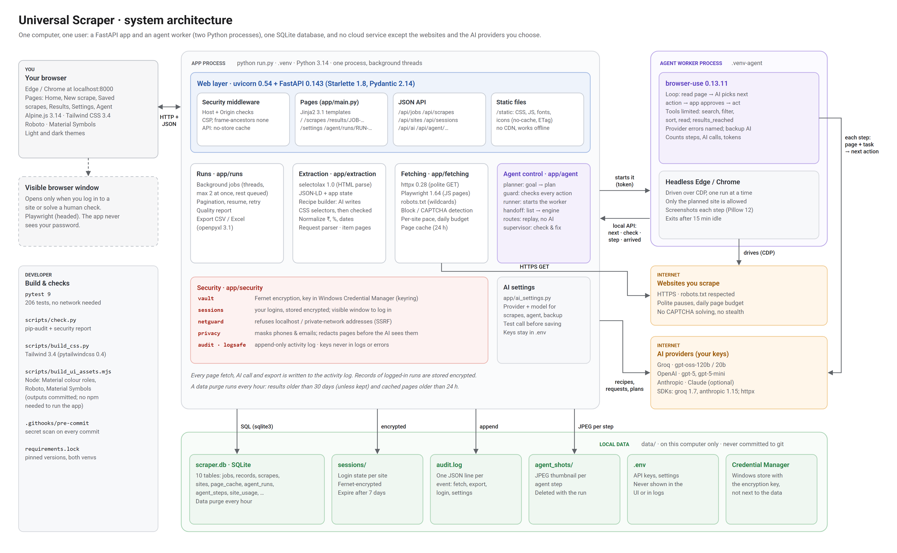

# Universal Scraper (draft v0.1)

A local web app that extracts listings from websites. You give it a page URL and the fields you
want. It finds the right CSS selectors (a **recipe**), shows you a preview, then crawls and lists
the results with CSV / Excel export.

Built-in recipes: **IndiaMART** and **TradeIndia** category pages. On any other site an AI model
writes the recipe for you, once per site: **Groq `openai/gpt-oss-120b`** by default, or Claude.
Without a key you can edit the starter recipe by hand.

## Setup

```bash
python -m venv .venv
.venv\Scripts\pip install -r requirements.txt
.venv\Scripts\python -m playwright install chromium   # optional: browser rendering (~150 MB)
copy .env.example .env        # then add GROQ_API_KEY=... (optional, enables AI recipes)
```

## Run

```bash
python run.py
```

It starts the server and opens http://localhost:8000 in your browser. It uses the project's `.venv`
automatically, whichever Python you start it with. Options: `--port 8080`, `--reload` (restart when code
changes), `--no-browser`.

## How to use

The app has its own address for each page, so refresh, back / forward and bookmarks work:

| Page | Address |
|---|---|
| Home | `/` |
| New scrape (and Edit) | `/scrapes/new`, `/scrapes/{id}/edit` |
| Saved scrapes | `/scrapes` |
| Results (one job, one tab: Data, Quality, Changes, Info) | `/results`, `/results/JOB-7K3QX9`, `/results/JOB-7K3QX9?tab=info` |
| Settings | `/settings` |
| Agent workspace (one agent run) | `/agent`, `/agent/runs/RUN-7K3QX9` |

Every job gets its own **Job ID** (like `JOB-7K3QX9`, no look-alike letters) and every agent run a **Run ID**
(`RUN-7K3QX9`). They are what the app shows and links to, and downloads are named after the Job ID
(`Books-JOB-7K3QX9.csv`); old links with a number move to the ID address.

The look is clean and neutral, inspired by Material Design (Roboto, Material Symbols icons) without copying it:
dark buttons on light surfaces in the light theme, light buttons on dark surfaces in the dark theme, and colour
only for status (finished, needs you, failed).

1. **Home → paste a link** (or pick a type of data: products, jobs, real estate, stock tables,
   directories, news, anything else). Use a page that *lists* many items: a category, search
   results or a table. No link handy? *Try a sample bookshop*.
2. **New scrape, step 1 · Link + what you need.** Paste the link and **describe the data you need**
   in your own words, for example *"I need the image, price and brand of each shoe. Only men's shoes
   under ₹3,000, cheapest first."* (the example buttons fill in a starting point). Click **Continue**:
   the AI turns it into **Here's what we'll collect**: columns (hover for what each one means, and
   its type: price, number, date, rating, link, image), conditions ("price < 3000", "name contains
   men"), sorting and a limit. Rename, remove or add any of them, then **Find the data**. Prefer a
   plain list? *or just list the columns* gives the comma-separated box (empty = the AI picks).
3. **Step 2 · Columns.** See how many items were found and how many **match your request**, the
   columns as chips (rename, **×** remove, *Add a column…*), how often each was found, and the
   preview exactly as it will be saved: prices and counts as numbers, dates as dates, sorted and
   filtered. A column that isn't on the list page is named, with the suggestion to switch on
   **Also open each item's own page**: the AI reads one item page, finds the missing details (specs,
   description, salary, seller…) and shows them from the first item. Runs then open every item's
   page (slower, same polite pauses).
4. **Step 3 · Collect.** Name the scrape, choose how many pages or tick **Collect all pages** (up to
   50; it stops when no new items appear), then **Start collecting** (or *Save for later*). When the
   site states a total ("1,000 results"), you see it here.
5. **Results.** Every run, with plain-language progress. Three tabs:
   - **Data**: search, sort, choose columns, download **Excel** (real number and date cells) or **CSV**.
     Fix any value in place: hover a cell and click ✎ (or double-click it), type, press Enter (Esc cancels).
     The new value keeps the column's type, is marked with a dot, and is used in downloads and Changes.
   - **Quality**: rows saved, pages read and failed, duplicates removed, items that didn't match your
     request, **coverage** (collected vs. the site's stated total) and how complete each column is,
     with plain warnings. Failed pages are retried once automatically; **Retry failed pages** tries
     again later. If columns that used to be full come out empty, the site probably changed:
     **Re-detect columns** lets the AI set them up again.
   - **Changes**: new, gone and changed items since the scrape's previous run (e.g. price changes).
6. **Saved scrapes.** Each setup keeps your description: **Run again** for fresh data, open the latest
   results, edit (step 1 shows your description, so changing "under ₹3,000" to "under ₹5,000" is one
   edit), rename, duplicate or delete.

### Agent mode (new)

For when you only know the goal. Open **Agent** in the sidebar (or *Let the agent do it* on Home): it opens
its own full-screen workspace, with your past agent runs on the left and **Back to Universal Scraper** at the
top. Describe
what to collect and name the website, for example *"Hockey teams whose name contains 'New': team name,
year, wins, losses. All pages."* on `scrapethissite.com/pages/forms/`.

1. **Make a plan**: the AI writes the steps it will take on the site (search, categories, filters, sort),
   the columns with their types, conditions, pages and item pages. Change anything, then **Start the agent**.
2. The agent ([browser-use](https://github.com/browser-use/browser-use)) opens the site in Edge / Chrome,
   declines cookie pop-ups, uses the site's own search box and filters, and stops on the results list.
   You see every step with small screenshots, and can **Stop** at any time.
3. The normal engine collects the results (all pages, item pages, typed values, conditions, quality
   report), and the run is saved as a normal saved scrape with an *Agent* chip. **Run again** needs no AI.

The agent stays on the site you named, follows robots.txt, and only searches, filters and reads. The app
checks every page and action first and refuses buying, contacting, applying, posting, signing up,
logging in and typing personal data. Human checks (CAPTCHAs) are never solved: the run stops as *Needs
you*; **Open to solve** lets you solve it yourself, then **Try again**. Each run has limits for steps,
minutes and AI calls (Settings → Agent mode shows the defaults).

Agent mode runs in its own environment, so its packages never mix with the app's:

```bash
python -m venv .venv-agent
.venv-agent\Scripts\pip install -r agent_worker\requirements.txt
```

It works best with an AI that can see screenshots: add `ANTHROPIC_API_KEY` or `OPENAI_API_KEY` (it is
then used for the agent; Groq still does the rest unless `SCRAPER_AI_PROVIDER` says otherwise). With only Groq it runs text-only on gpt-oss-120b, which worked on the
test sites but is slower and less reliable on complex sites.

**Check and fix.** After collecting, the agent reads the run's quality report and fixes what it can, at
most two rounds: a requested column missing or mostly empty → it turns on item pages; fewer than 90% of
the items the site lists and the run hit its page limit → more pages; only one page read of many → it
finds the next-page control; recorded steps broken → it finds the way again. Each fix and its reason is
listed on the result card; pages already read come from the cache. Untick *Check the results and fix
problems* on the plan to only get the report.

**Running it again needs no AI.** If the filters end up in the page address, the saved scrape is just that
address. If they exist only inside the page (clicking "2012" loads that year's films, the address stays
the same), the agent's steps are saved as a **route**: before saving, the app replays them once with
plain Playwright to check they reach the same results, and every later run replays them the same way
(the saved scrape shows *Replays N recorded steps · no AI*; the Quality tab shows *Steps replayed*).
Cookie and pop-up clicks that don't appear any more are skipped. If a step can't be done because the
site changed, the run stops with a clear message and **Re-record with the agent** (on the run, or in the
saved scrape's menu) lets the agent find the way again and updates the same saved scrape.

**Light / dark theme:** the button in the top bar cycles System → Light → Dark (also in Settings).

**Advanced mode** (switch in Settings) shows the technical parts: the column setup
as JSON, per-site settings (page limits, waiting time, browser loading), logins and the activity log.

Search pages are often blocked by a site's crawling rules (robots.txt); the app explains this and
suggests a category page instead. For example, IndiaMART allows `dir.indiamart.com/impcat/...`.

## Changing the UI

Everything the page needs is served by the app itself (no CDNs), so it works offline and behind company
firewalls.

- **Pages:** one Jinja2 template per page in `frontend/templates/` (`base.html` is the shared frame,
  `partials/` the shared dialogs and banners, `agent/workspace.html` the Agent workspace) and one script per
  page in `frontend/public/js/pages/`. `js/core.js` holds what every page shares (Alpine.js). Templates never
  contain inline scripts; page data travels in `data-*` attributes.
- **Styles:** Tailwind with Material 3 component classes, compiled from `frontend/src/app.css`:

  ```bash
  python scripts/build_css.py           # once
  python scripts/build_css.py --watch   # while editing templates or page scripts
  ```

  `pip install pytailwindcss` provides the Tailwind CLI. The compiled `frontend/public/css/app.css` is committed.
- **Design assets:** the Material 3 colour roles (`frontend/src/theme.css`), Roboto (`public/fonts/`) and the
  Material Symbols icons (`public/js/icons.js`) are generated from Google's packages:

  ```bash
  node scripts/build_ui_assets.mjs      # only when changing the brand colour or adding an icon
  ```

  To use another icon, add its [Material Symbols](https://fonts.google.com/icons) name to `ICONS` in that
  script, run it, then `icon('name')` in a template. The outputs are committed, so running the app never
  needs npm.

## Logged-in pages, CAPTCHAs and personal data

- **Logging in** (Advanced mode): *Settings → Sites → Log in* first asks you to confirm it is your own account and
  that the site allows automated access while logged in, then opens a real browser window. You log in yourself
  (password, OTP, 2-step); the app only keeps the session cookie, encrypted with a key held in Windows
  Credential Manager, for that site only. Sessions expire after 7 days; *Forget session* deletes one.
  Jobs that use a session store their results encrypted and have a lower daily page budget.
- **CAPTCHAs and bot checks** are never solved automatically. A job that meets one pauses as
  **needs you**: click *Open to solve*, solve it in the window, and the job continues. If a second
  check appears within 10 minutes the job stops and the site cools down for an hour.
- **Personal data** (phone numbers, emails) is masked by default, in what is stored, shown and sent
  to the AI. To collect a field unmasked, tick it before starting the job and say why.
- **Activity log** lists every fetch, export, login and settings change.

Details: [docs/SECURITY.md](docs/SECURITY.md). Check everything with `python scripts/check.py`.

## Recipes

A recipe is plain JSON. See [app/extraction/extractor.py](app/extraction/extractor.py) for every option.

```json
{
  "item_selector": "div.product-info-cnt",
  "fields": [
    {"name": "name",  "selector": "a.title-url", "attr": "text"},
    {"name": "url",   "selector": "a.title-url", "attr": "href"},
    {"name": "price", "selector": "p.price-text", "regex": "([\\d,.]+)\\s*INR"},
    {"name": "min_order", "kind": "kv", "label_selector": ".spec-title",
     "value_selector": ".spec-value", "label": "MOQ"}
  ],
  "pagination": {"type": "next_link", "selector": "li.next a"}
}
```

Pagination types: `none`, `next_link` (follow a "next" anchor), `url_param` (e.g. `?page=2`),
`click` (press a "Load more" button, `selector` required) and `scroll` (infinite scroll). The last two
run in the browser; *Max pages per URL* is then the number of clicks / scrolls.

## Browser rendering (JavaScript sites)

Plain HTTP is always tried first. If the page comes back without listings, the app renders it in
headless Chromium (Playwright) and tries again; when that works, the site's **Page rendering** setting
is switched to *Always* so later fetches go straight to the browser. You can set it to *Plain HTTP only*
or *Always* yourself under *Site settings*. The browser follows the same rules as plain fetching:
robots.txt, the per-site delay, and stopping on CAPTCHA / challenge pages.

Tested on: `quotes.toscrape.com/js/` (JavaScript-only), `quotes.toscrape.com/scroll` (infinite scroll),
`webscraper.io/test-sites/e-commerce/more/...` (Load more button) and IndiaMART category pages (load
more products on scroll).

## Jobs

At most `SCRAPER_MAX_JOBS` (default 2) jobs crawl at the same time; others wait as *queued* and can be
stopped while waiting. Every fetched page is recorded, so a job interrupted by a restart resumes where
it stopped without duplicating rows.

Each page's rows are typed (`₹ 1,62,499` → 162499 plus `price_currency` INR; `2.5 Lakh` → 250000;
`4.5 out of 5` → 4.5; `2d ago` → a date), de-duplicated by the item's link, filtered by your request,
completed from item pages when that is on, and stored. At the end the request's sort and limit are
applied and the quality report is saved with the run.

Pages that carry their data as JSON (schema.org JSON-LD, `__NEXT_DATA__`, `window.__INITIAL_STATE__`)
are read from it when it is cleaner than the HTML; item pages often have a JSON-LD Product / JobPosting
with the price, brand or salary.

## Project layout

Pictures of the whole system, the tech stack with versions, both flows and the database are in
[docs/architecture](docs/architecture/README.md).



```
Web-Scraping/
├── README.md  run.py  requirements.txt  requirements.lock  .env.example
├── app/                  the web app (FastAPI)
│   ├── main.py           routes + serves the UI; Host / Origin checks, security headers
│   ├── config.py         settings (from .env)
│   ├── ai_settings.py    the AI provider and model chosen in Settings (checked, saved in the database)
│   ├── db.py             SQLite: recipes, jobs, records, page cache (data/scraper.db)
│   ├── fetching/         getting pages politely and safely
│   ├── security/         protecting you and your data
│   ├── extraction/       turning pages into clean rows
│   ├── runs/             background runs and their results
│   ├── agent/            Agent mode (plans, guard, handoff, routes, check & fix)
│   └── recipes/          built-in recipes, loaded at startup
├── frontend/             the UI
│   ├── templates/        one Jinja2 template per page (base.html, pages/, agent/, partials/)
│   ├── public/           served at /static: css/app.css, js/core.js + js/pages/*.js, js/icons.js, fonts/, img/
│   ├── src/              Tailwind source (app.css) and Material 3 colours (theme.css)
│   └── tailwind.config.js
├── agent_worker/         the browser-use process, in its own environment (.venv-agent)
├── scripts/              check.py (security report), build_css.py, build_ui_assets.mjs, secret_scan.py,
│                         architecture_diagrams.py (the pictures in docs/architecture)
├── tests/                python -m pytest tests (offline, on saved pages and a local test site)
├── docs/                 SECURITY.md and the plans behind each part of the app
└── data/                 your database, logins, logs (local only, never committed)
```

| Folder | Files |
|---|---|
| `app/fetching/` | `fetcher.py` (HTTP: robots.txt, per-site throttling, retries, cache, budgets; `fetch_smart` picks HTTP or browser) · `browser.py` (headless Chromium: wait, "load more", scroll) · `robots.py` (robots.txt with `*` / `$` wildcards) · `blockdetect.py` (CAPTCHA, challenge, access-denied and login pages) |
| `app/security/` | `netguard.py` (refuses local / private network targets) · `vault.py` (encryption key in the OS credential store) · `sessions.py` (encrypted logins; visible windows for logging in / solving checks) · `privacy.py` (masks phones / emails; redacts page text before AI calls) · `audit.py` (activity log) · `logsafe.py` (keeps secrets out of logs) |
| `app/extraction/` | `extractor.py` (applies a recipe to HTML or embedded JSON; pagination) · `recipe_builder.py` (finds the listing, asks the AI for a recipe, tests it; item-page recipes) · `request_parser.py` ("Describe what you need" → columns, conditions, sort, limit) · `normalize.py` (money, numbers, ratings, dates) · `structured.py` (JSON-LD and embedded app data) · `details.py` (item pages) |
| `app/runs/` | `jobs.py` (background runs: typing, de-duplication, conditions, item pages, retries) · `quality.py` (quality report and health check) · `export.py` (CSV / Excel) |
| `app/agent/` | `planner.py` (goal → plan) · `guard.py` (what the agent may do) · `api.py` (UI + worker API) · `handoff.py` (results page → engine) · `routes.py` (record and replay steps without AI) · `supervisor.py` (check and fix) · `runner.py` (starts the worker) · `store.py` (runs and steps) |
| `agent_worker/` | `worker.py` (browser-use, talks to the app's local API with a one-time token) · `requirements.txt` / `.lock` |
| `scripts/` | `check.py` (security report) · `build_css.py` (Tailwind build, only to change the UI) · `build_ui_assets.mjs` (Material 3 colours, Roboto, Material Symbols from Google's packages) · `secret_scan.py` (also the pre-commit hook in `.githooks/`) |

## Settings (`.env`)

**Choosing the AI in the app:** *Settings → AI models* picks the provider (Groq, ChatGPT / OpenAI, Claude)
and the model, separately for building scrapes and for the agent. The lists come from each provider, and
saving sends one short test message to each newly picked model. The choice is saved in the database and
overrides the provider and model settings below. Keys always stay in
`.env`: a provider without a key can't be picked, and the page never sees a key.

| Setting | Default | Notes |
|---|---|---|
| `SCRAPER_AI_PROVIDER` | `groq` if `GROQ_API_KEY` is set, else `anthropic` | |
| `GROQ_API_KEY` / `SCRAPER_GROQ_MODEL` | — / `openai/gpt-oss-120b` | |
| `ANTHROPIC_API_KEY` / `SCRAPER_CLAUDE_MODEL` | — / `claude-opus-5-5` | |
| `OPENAI_API_KEY` / `SCRAPER_OPENAI_MODEL` | — / `gpt-5-mini` | `SCRAPER_AI_PROVIDER=openai` uses it for columns, requests and item pages |
| `SCRAPER_AI_PROMPT_CHARS` | 11000 (Groq), 60000 (Claude) | Size of the whole AI prompt. Long links are shortened, and if the provider still says "too large" the app trims the sample and retries by itself |
| `SCRAPER_MIN_DELAY` / `SCRAPER_MAX_DELAY` | 2 / 5 s | Wait between requests to the same site |
| `SCRAPER_MAX_PAGES` | 10 | Per start URL (or scroll / click rounds) |
| `SCRAPER_MAX_JOBS` | 2 | Jobs crawling at the same time |
| `SCRAPER_DAILY_BUDGET` / `_LOGGED_IN` | 500 / 200 | Pages per site per day |
| `SCRAPER_SESSION_MAX_AGE_DAYS` | 7 | Saved logins expire after this |
| `SCRAPER_JOB_RETENTION_DAYS` | 30 | Finished jobs are deleted after this unless kept |
| `SCRAPER_ALLOW_HOSTS` / `SCRAPER_BLOCKED_DOMAINS` | — | Network-guard exceptions / do-not-scrape list |
| `SCRAPER_CACHE_TTL_HOURS` | 24 | Page cache |
| `SCRAPER_AGENT` | 1 | `0` turns Agent mode off |
| `SCRAPER_AGENT_PROVIDER` / `SCRAPER_AGENT_MODEL` | `anthropic` + `claude-sonnet-5-5` if `ANTHROPIC_API_KEY` is set, else `openai` + `SCRAPER_OPENAI_MODEL` if `OPENAI_API_KEY` is set, else `groq` + gpt-oss-120b | The AI that drives the browser |
| `SCRAPER_AGENT_FALLBACK_PROVIDER` / `SCRAPER_AGENT_FALLBACK_MODEL` | none | Backup AI for the agent: takes over when its own AI hits a rate or daily limit, runs out of credit or refuses the key (also in Settings → AI models) |
| `SCRAPER_AGENT_MAX_STEPS` / `_MAX_MINUTES` / `_MAX_AI_CALLS` | 40 / 10 / 60 | Default limits per agent run |
| `SCRAPER_DATA_DIR` | `data/` | Where the database, logins, logs and screenshots live (e.g. a separate folder for a test copy of the app) |
| `SCRAPER_AGENT_SHOW_BROWSER` | 0 | `1` shows the agent's browser window |

## What's next

- Product (company server, guided screens, saved scrapes, admin): [04-product.md](docs/plans/04-product.md)
- Security and logged-in scraping: [03-security.md](docs/plans/03-security.md) (SSRF guard, safe exports,
  encrypted login sessions, pause-and-resume on CAPTCHAs, personal-data protection).
- Features: [02-features.md](docs/plans/02-features.md): browser rendering for JavaScript sites, detail-page crawling, clean numeric
output, recipe auto-repair, scheduled re-runs with price history, a point-and-click field picker.
- Complete data and the describe-what-you-need prompt: [05-data.md](docs/plans/05-data.md) (built).
- Agent mode with browser-use: [06-agent.md](docs/plans/06-agent.md) (phases 1–3 built).

## Ground rules built in

- robots.txt is checked before every fetch, and disallowed pages are refused.
- On HTTP 401/403/429 or a CAPTCHA page, the job stops instead of trying to get around it.
- Only public listing data is collected. Phone numbers and emails behind login are not.
- For local, personal use. Don't expose this server publicly.
