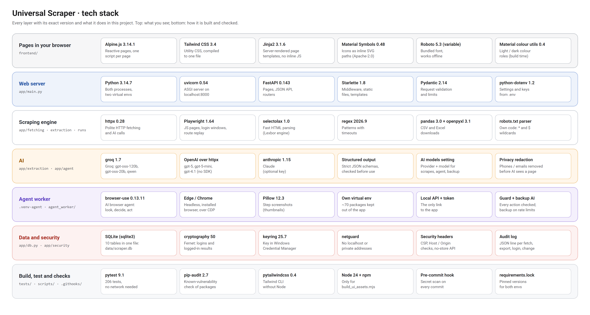
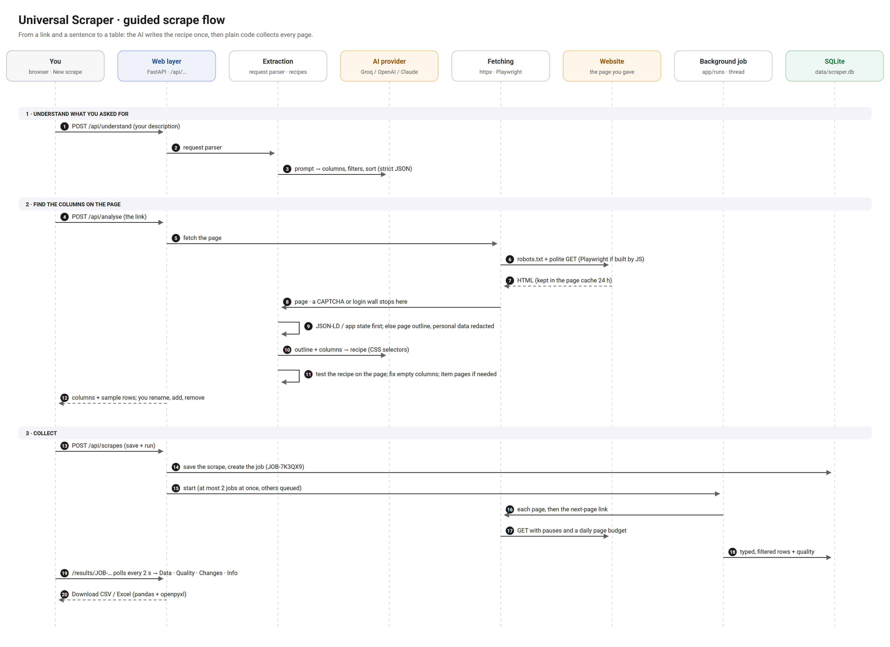
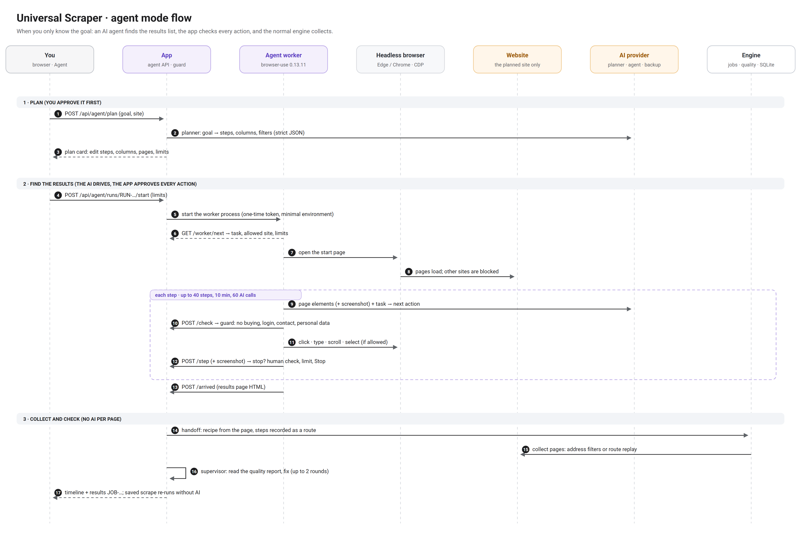
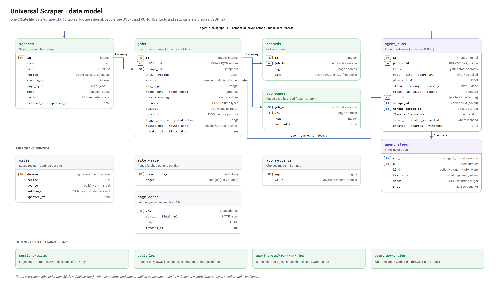

# Architecture

Five pictures of how Universal Scraper is built, from the whole system down to the database. They are drawn by
`scripts/architecture_diagrams.py`; update the boxes there when the architecture changes and run:

```bash
python scripts/architecture_diagrams.py
```

## 1 · System overview

The two Python processes (the app and the agent worker), every module group inside the app, the local data,
and the only outside services: the websites you scrape and the AI providers you choose.


## 2 · Tech stack

Every layer with its exact version and what it does here, from the pages you see to how the project is built
and checked.



## 3 · Guided scrape flow

From a link and a sentence to a table: the AI writes the recipe once, then plain code collects every page.



## 4 · Agent mode flow

When you only know the goal: the agent finds the results list, the app approves every action, and the normal
engine collects.



## 5 · Data model

The 10 tables in `data/scraper.db`, their keys and links, and the files kept next to the database.


